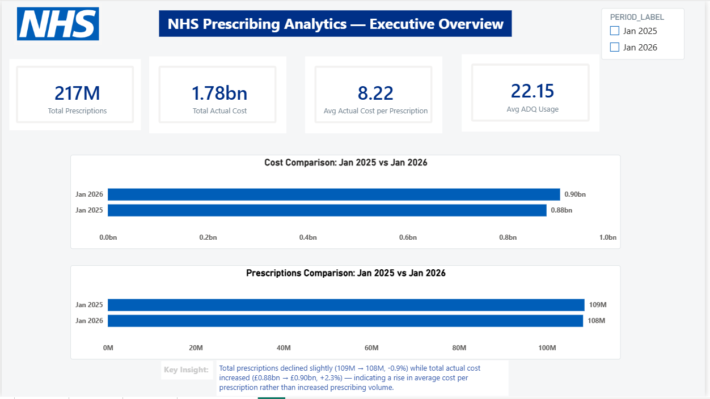
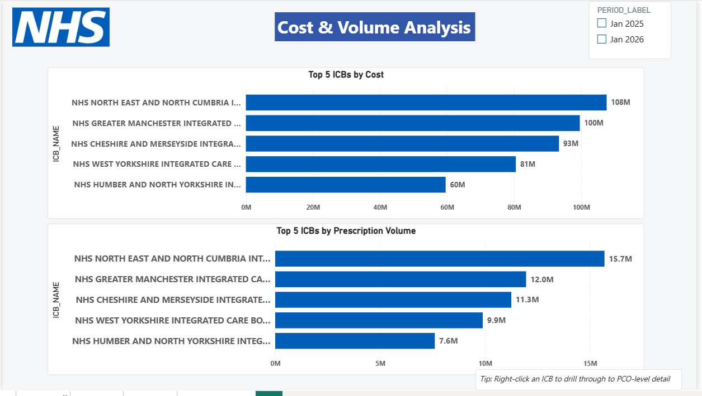
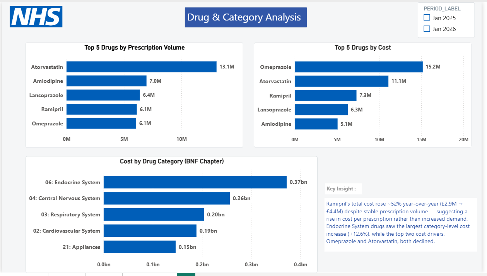
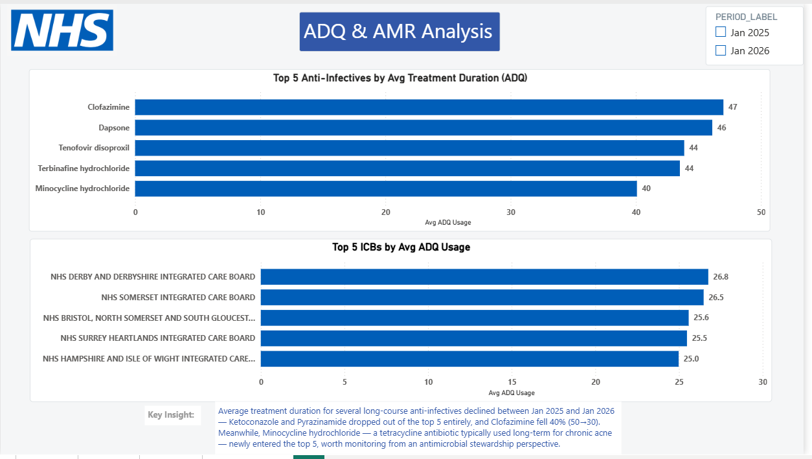
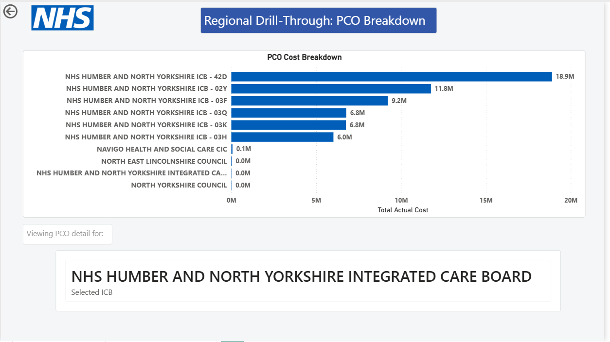
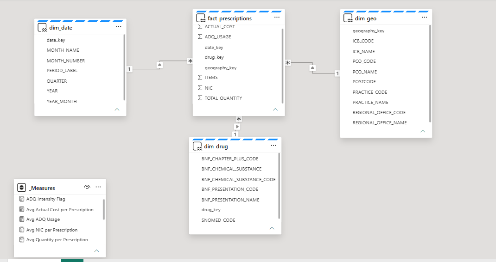
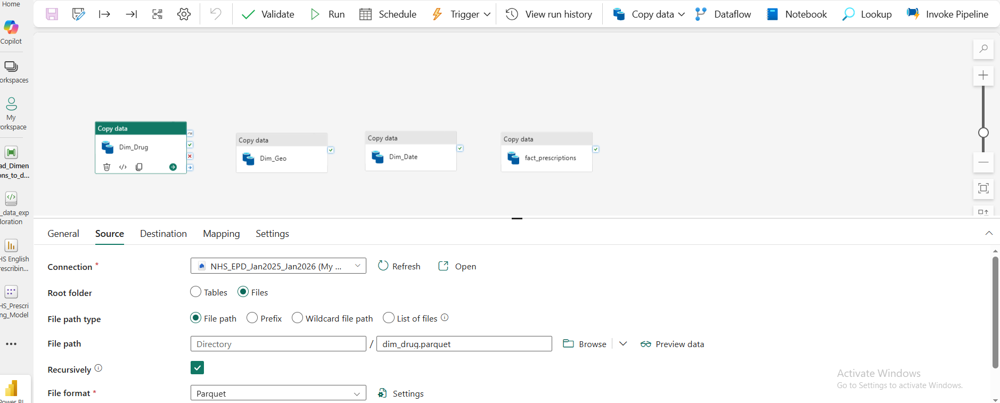
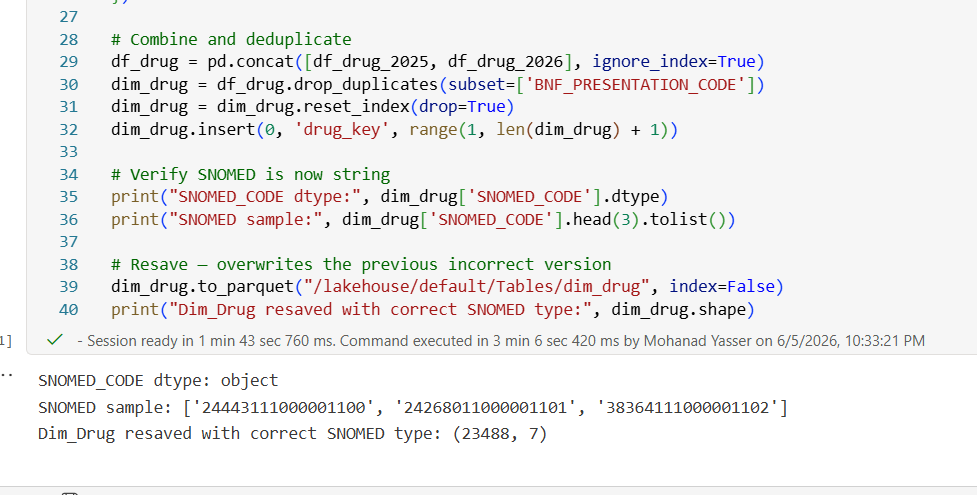
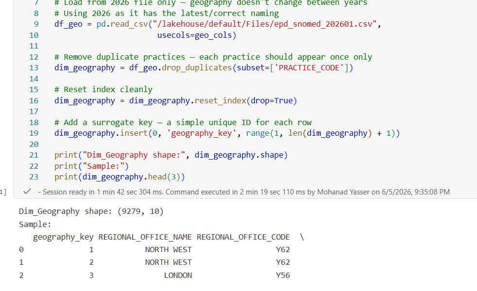
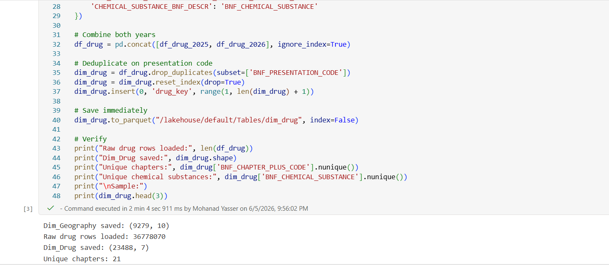

# NHS England Prescribing Analytics — Jan 2025 vs Jan 2026

End-to-end BI project analyzing NHS England prescribing data, comparing January 2025 to January 2026 across **36.7M+ records**. Built on Microsoft Fabric (Lakehouse + Direct Lake) with a Python ETL pipeline and a Power BI report.

## 🔍 Overview

- **Data source:** [NHS BSA English Prescribing Dataset (EPD) with SNOMED Code](https://opendata.nhsbsa.net/dataset/english-prescribing-dataset-epd-with-snomed-code)
- **Scope:** NHS England primary care prescribing, January 2025 and January 2026
- **Stack:** Microsoft Fabric (Lakehouse, OneLake, Notebooks), Python (pandas), Power BI (Direct Lake)

## 🏗️ Architecture
NHS BSA Open Data (CSV)

↓

Fabric Pipeline — Copy Data activities

↓

Lakehouse (raw files)

↓

Python/pandas ETL (Fabric Notebook)

↓

Star Schema (Delta tables in OneLake)

↓

Power BI (Direct Lake semantic model)

↓

5-page interactive report

**Star schema:**
- `fact_prescriptions` (~36.7M rows) — ACTUAL_COST, NIC, ITEMS, TOTAL_QUANTITY, ADQ_USAGE
- `dim_drug` (23,488 rows) — BNF chapter, chemical substance, SNOMED code
- `dim_geography` (9,279 rows) — ICB, PCO, Practice hierarchy
- `dim_date` — year, month, period label

## ⚙️ Engineering Challenges Solved

Building this surfaced six real data engineering problems — not a clean tutorial dataset:

1. **Schema drift** between the 2025 and 2026 source file releases
2. **YEAR_MONTH format mismatch** causing silent join failures
3. **SNOMED code scientific notation** — numeric dtype inference corrupted long codes; fixed by forcing string type
4. **Parquet/Delta table recognition** issues in the Lakehouse
5. **Surrogate key int64→float64 null promotion** breaking joins
6. **Direct Lake workspace capacity** constraints requiring model optimization

## 📊 Report Pages

| Page | Purpose |
|---|---|
| Executive Overview | Headline KPIs, Jan 2025 vs Jan 2026 comparison |
| Cost & Volume Analysis | Geographic cost/volume breakdown by ICB |
| Drug & Category Analysis | Top drugs and BNF categories by cost and volume |
| ADQ & AMR Analysis | Prescribing intensity and antimicrobial stewardship insight |
| PCO Detail (drill-through) | Region-level investigation from any ICB |

## 💡 Key Insights

- **Cost outpaced volume:** prescriptions declined slightly (109M → 108M, -0.9%) while cost rose (£0.88bn → £0.90bn, +2.3%) — a rise in average cost per prescription, not demand.
- **Ramipril cost rose ~52%** year-over-year (£2.9M → £4.4M) on stable volume — a pure cost-per-prescription effect.
- **Antimicrobial stewardship signal:** average treatment duration for several long-course anti-infectives (Ketoconazole, Pyrazinamide) declined, while two tetracycline-class antibiotics typically used long-term for chronic acne (Minocycline, Lymecycline) newly entered the top ADQ rankings — worth monitoring, though not evidence of a resistance trend on its own.

## 🖼️ Screenshots

> Note: the live report ran on a Fabric trial capacity that has ended, so Direct Lake can't load. These screenshots show the finished report and the pipeline.

**Report pages**

**Data model and pipeline**

**ETL notebook (SNOMED string fix, dimension builds)**

## 🛠️ Tech Stack

`Microsoft Fabric` `Power BI` `Python` `pandas` `Direct Lake` `DAX` `Delta Lake` `OneLake`

---

Built by Mohanad Yasser — BI & Integration Analyst with a clinical pharmacy background.
